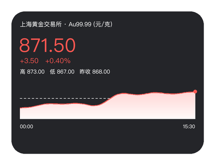
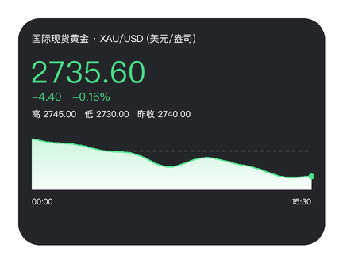

# GoldTicker · 极简实时金价桌面悬浮小组件

[](https://github.com/realsuperj/gold-ticker/actions)
[](LICENSE)

一个极简、优雅的跨平台桌面金价悬浮小组件：支持 **上海黄金交易所 Au99.99**、**国际现货金 (XAU/USD)** 以及以 **浙商银行积存金**（及工行、建行）为代表的主流银行积存金实时行情。macOS 原生毛玻璃卡片与顶部菜单栏，Windows 轻量自绘托盘与桌面悬浮窗。





---

## 核心特点

- 🌟 **全口径黄金行情**：聚合上海黄金交易所 Au99.99 权威基准、国际现货金（XAU/USD，元/克与美元/盎司自动折算），并支持以浙商银行为代表的商业银行积存金多源实时追踪；
- 🪟 **极简原生质感**：macOS 原生毛玻璃悬浮卡片与顶部菜单栏轻量常驻；Windows 动态自绘任务栏状态条，安静陪伴不遮挡视线；
- 📈 **动态分时走势**：内置平滑分时折线，行情异动一目了然；支持一键开启/折叠走势图，卡片高度自适应伸缩；
- 🔄 **双入口随心调度**：桌面卡片与系统状态栏/托盘双重入口，支持按需隐藏桌面卡片，随时从菜单栏快捷唤起；
- 🎨 **个性化看盘习惯**：国内习惯（红涨绿跌）与国际习惯（绿涨红跌）一键切换；支持多档透明度调节、窗口置顶与智能坐标记忆。

---

## 安装与快速启动

### 方式一：直接下载发布包 (推荐)
前往项目的 [Releases](https://github.com/realsuperj/gold-ticker/releases) 页面下载对应系统的最新发布包：
- **macOS**：下载 `GoldTicker-macOS-Universal2.dmg`，双击拖入 `Applications` 即可运行；
- **Windows**：直接下载单个免安装绿色版 `GoldTicker.exe`（或 `GoldTicker-Windows-x64.zip`），双击即可运行，无任何外部依赖。

### 方式二：源码运行与本地安装

#### macOS 本地安装与启动
```bash
# 1. 安装依赖 (Python 3.9+)
pip install -r requirements.txt

# 2. 本地安装为系统应用并自动启动
./install.sh                # 安装至 ~/Applications/GoldTicker.app
./install.sh --autostart    # 同时设置开机自启动（开机进入桌面自动运行，无需任何账号）
```

#### Windows 本地启动
```powershell
# 1. 安装依赖
pip install -r requirements.txt

# 2. 启动 Windows 表现层
python windows/main.py
```

---

## 菜单控制说明 (Action Matrix)

右键点击桌面悬浮卡片，或点击顶部菜单栏 / 任务栏托盘图标，均可弹出全量控制菜单：

| 控制分类 | 功能项 | 说明 |
| :--- | :--- | :--- |
| **视图入口** | 显示到桌面 / 显示到托盘 | 支持独立隐藏桌面卡片，保留状态栏常驻 |
| **图表辅助** | 显示走势图 / 显示高低基准 | 走势图自适应展开与折叠；辅助展示今开、昨收、最高、最低 |
| **层级调整** | 窗口置顶 | 浮动在所有窗口之上 / 普通桌面层级切换 |
| **标的切换** | Au99.99 / 国际现货金 / 浙商积存金 | 支持人民币元/克与国际美元/盎司实时换算与切换 |
| **涨跌基准** | 昨收价 / 今开价 | 切换涨跌额与涨跌幅度的计算参考基准 |
| **红绿配色** | 红涨绿跌 (国内) / 绿涨红跌 (国际) | 适配个人习惯色彩体系 |
| **刷新频率** | 10秒 / 30秒 / 60秒 / 300秒 | 灵活调节数据更新频率 |
| **卡片定制** | 宽度 (180~280pt) / 透明度 (50%~100%) | 界面自适应多档排版调节 |
| **数据管理** | 打开配置目录 / 清除走势缓存 / 重置位置 | 一键定位配置文件，重置窗口至屏幕右上角 |

---

## 许可证与免责声明

- 本项目采用 **[MIT License](LICENSE)** 开源，版权所有 © 2026 realsuperj。
- **免责声明**：本软件仅供个人行情参考与学习交流，不构成任何投资建议或交易依据。数据来源于公开第三方网络接口，存在网络传输延迟，实际成交以各银行及交易所官方客户端为准。
