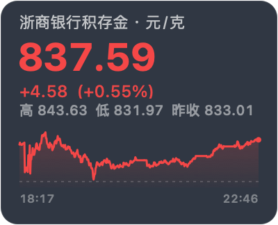
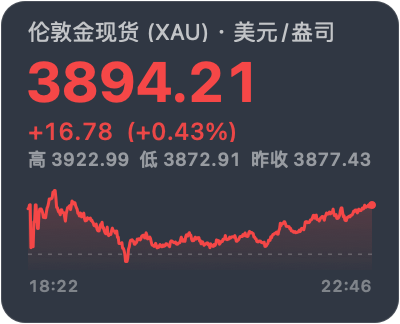

<div align="center">


# GoldTicker

### 极简实时金价桌面悬浮小组件 · 跨平台轻量看盘利器

<p align="center">
  <b>简体中文</b> | <a href="README_EN.md">English</a>
</p>

[](https://github.com/realsuperj/gold-ticker/actions)
[](LICENSE)
[](https://github.com/realsuperj/gold-ticker/releases)

<p align="center">
  支持 <b>上海黄金交易所 Au99.99</b>、<b>国际现货金 (XAU/USD)</b> 以及以 <b>浙商银行积存金</b>（及工行、建行）为代表的主流银行积存金实时行情。<br/>
  macOS 原生毛玻璃悬浮卡片与顶部菜单栏，Windows 轻量自绘托盘与桌面悬浮窗。
</p>

<p align="center">
  
  
</p>
<p align="center">
  <sub>浙商银行积存金（元/克）与国际现货黄金（美元/盎司）。正式 macOS 卡片 + 当日真实采样截图。</sub>
</p>

</div>

---

## 核心特点

- 🌟 **全口径黄金行情**：聚合上海黄金交易所 Au99.99 权威基准、国际现货金（XAU/USD 原汁原味美元报价与元/克无缝对照），并支持以浙商银行为代表的商业银行积存金多源实时追踪；
- 🪟 **极简原生质感**：macOS 原生毛玻璃悬浮卡片与顶部菜单栏轻量常驻；Windows 动态自绘任务栏状态条，安静陪伴不遮挡视线；
- 📈 **动态分时走势**：内置平滑分时折线与昨收基准参考线，行情异动一目了然；支持一键开启/折叠走势图，卡片高度自适应伸缩；
- 🔄 **双入口随心调度**：桌面卡片与系统状态栏/托盘双重入口，支持按需隐藏桌面卡片，随时从菜单栏快捷唤起；
- 🎨 **习惯跟着人走**：配色体系完全基于个人视觉偏好，国内习惯（红涨绿跌）与国际习惯（绿涨红跌）一键全局切换；无论切换任何标的，始终遵循选定法则；
- 🌐 **轻量双语国际化**：支持简体中文与英文（English），支持跟随系统语言或在菜单中手动指定。

---

## 标的覆盖与银行积存金点差机制说明

GoldTicker 严格保障金融数据的透明度与准确性，当前收录的 5 大核心标的取数与计算口径如下：

| 标的代码 | 显示名称 | 计量单位 | 实时数据源机制 | 备注说明 |
| :--- | :--- | :--- | :--- | :--- |
| `au9999` | 上海黄金交易所 Au99.99 | 元/克 (CNY/g) | 上金所公开行情直连 | 国内黄金现货官方权威参考基准 |
| `xau_usd` | 国际现货黄金 (XAU/USD) | 美元/盎司 (USD/oz) | 国际伦敦金现货直连 | 原生美元报价，杜绝汇率二次失真 |
| `zs_jcj` | 浙商银行积存金 | 元/克 (CNY/g) | 浙商银行公开牌价直连 | 银行官方实时牌价直连接口 |
| `icbc_jcj` | 工商银行积存金 | 元/克 (CNY/g) | Au99.99 基准 + **0.80 元/克** | **点差估算**（因工行无公开免密 API，按日常平均点差拟合） |
| `ccb_jcj` | 建设银行积存金 | 元/克 (CNY/g) | Au99.99 基准 + **0.75 元/克** | **点差估算**（因建行无公开免密 API，按日常平均点差拟合） |

> **点差估算说明**：工商银行与建设银行积存金牌价因缺乏公开免密行情接口，小组件采用“上金所 Au99.99 实时基准价 + 银行日常点差模型”进行拟合估算，并在界面明确标注点差估算，方便投资者横向对比各大行价格走势，实际买卖成交价请以各银行官方手机银行客户端为准。

---

## 安装与快速启动

### 方式一：直接下载发布包 (推荐)
前往项目的 [Releases](https://github.com/realsuperj/gold-ticker/releases) 页面下载对应系统的最新发布包：
- **macOS**：下载 `GoldTicker-macOS-Universal2.dmg`（Intel / Apple Silicon），双击拖入 `Applications` 即可运行；
- **Windows**：直接下载单个免安装绿色版 `GoldTicker.exe`（或 `GoldTicker-Windows-x64.zip`），双击即可运行，无任何外部依赖。

### 方式二：源码运行与本地安装

源码统一使用 `python goldticker.py`（macOS 和 Windows），可从任意工作目录使用绝对路径启动。

本地和 CI 均使用 `python tools/build.py` 与 `GoldTicker.spec`（`target_arch=universal2`），产物为 `GoldTicker-macOS-Universal2.dmg`。`python goldticker.py --smoke-test` 在临时配置目录运行离线原生界面冒烟。

#### macOS 本地安装与启动
```bash
# 1. 安装依赖 (Python 3.9+)
pip install -r requirements.txt
pip install "pyinstaller>=6.11,<7"

# 2. 本地安装为系统应用并自动启动
./install.sh                # 安装至 ~/Applications/GoldTicker.app
./install.sh --autostart    # 同时设置开机自启动（开机进入桌面自动运行，无需任何账号）
```

#### Windows 本地启动
```powershell
# 1. 安装依赖
pip install -r requirements.txt
pip install "pyinstaller>=6.11,<7"

# 2. 启动 Windows 表现层
python goldticker.py
```

---

## 菜单控制说明 (Action Matrix)

右键点击桌面悬浮卡片，或点击顶部菜单栏 / 任务栏托盘图标，均可弹出全量控制菜单：

| 控制分类 | 功能项 | 说明 |
| :--- | :--- | :--- |
| **视⁠图⁠入⁠口** | 显示到桌面 / 显示到托盘 | 支持独立隐藏桌面卡片，保留状态栏常驻 |
| **图⁠表⁠辅⁠助** | 显示走势图 / 显示高低基准 | 走势图自适应展开与折叠；辅助展示今开、昨收、最高、最低 |
| **层⁠级⁠调⁠整** | 窗口置顶 | 浮动在所有窗口之上 / 普通桌面层级切换 |
| **标⁠的⁠切⁠换** | Au99.99 / 国际金 / 浙商 / 工行 / 建行 | 支持人民币元/克与国际美元/盎司快速切换 |
| **涨⁠跌⁠基⁠准** | 昨收价 / 今开价 | 切换涨跌额与涨跌幅度的计算参考基准 |
| **色⁠彩⁠偏⁠好** | 红涨绿跌 (国内) / 绿涨红跌 (国际) | 偏好跟着人走，全局生效，不随标的跳变 |
| **语⁠言⁠切⁠换** | 跟随系统 / 简体中文 / English | 轻量化全界面双语无缝切换 |
| **刷⁠新⁠频⁠率** | 10秒 / 15秒 / 30秒 / 60秒 / 300秒 | 灵活调节数据更新频率 |
| **卡⁠片⁠定⁠制** | 宽度 (180~280pt) / 透明度 (60%~100%) | 界面自适应多档排版调节 |
| **数⁠据⁠管⁠理** | 打开配置目录 / 重置位置 / 重新加载 | 一键定位配置文件，重置窗口至屏幕右上角 |

---

## 许可证与免责声明

- 本项目采用 **[MIT License](LICENSE)** 开源，版权所有 © 2026 realsuperj。
- **免责声明**：本软件仅供个人行情参考与学习交流，不构成任何投资建议或交易依据。数据来源于公开第三方网络接口，存在网络传输延迟，实际成交以各银行及交易所官方客户端为准。
