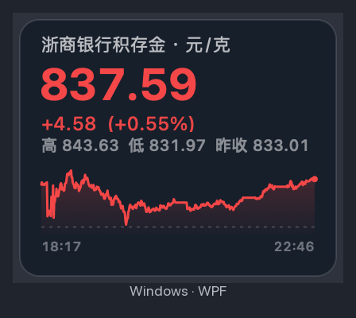

<div align="center">


# GoldTicker

### 极简实时金价桌面悬浮小组件 · 跨平台轻量看盘利器

<p align="center">
  <b>简体中文</b> | <a href="README_EN.md">English</a>
</p>

[](https://github.com/realsuperj/gold-ticker/releases/tag/v1.2.0)
[](https://github.com/realsuperj/gold-ticker/actions)
[](LICENSE)
[](https://github.com/realsuperj/gold-ticker/releases)

<p align="center">
  <a href="https://github.com/realsuperj/gold-ticker/releases/latest/download/GoldTicker-macOS-Universal2.dmg"><strong>⬇️ macOS 下载 DMG</strong></a>
  &nbsp;·&nbsp;
  <a href="https://github.com/realsuperj/gold-ticker/releases/latest/download/GoldTicker.exe"><strong>⬇️ Windows 下载 EXE</strong></a>
  &nbsp;·&nbsp;
  <a href="https://github.com/realsuperj/gold-ticker/releases/latest">全部发布包</a>
</p>

<p align="center">
  支持 <b>上海黄金交易所 Au99.99</b>、<b>国际现货金 (XAU/USD)</b> 以及以 <b>浙商银行积存金</b>（及工行、建行）为代表的主流银行积存金实时行情。<br/>
  macOS：原生毛玻璃桌面卡片 + 菜单栏；Windows：原生 WPF 桌面悬浮卡片（不占用任务栏、无宽条行情）。
</p>

<p align="center">
  
  
</p>
<p align="center">
  <sub>左：macOS · 右：Windows（WPF）。浙商积存金实盘样式示意。</sub>
</p>

</div>

---

## 核心特点

- 🌟 **全口径黄金行情**：聚合上海黄金交易所 Au99.99 权威基准、国际现货金（XAU/USD 原汁原味美元报价与元/克无缝对照），并支持以浙商银行为代表的商业银行积存金多源实时追踪；
- 🪟 **极简原生质感**：macOS 为 AppKit 毛玻璃悬浮卡片与菜单栏常驻；Windows 为 .NET Framework 4.8 + WPF 桌面悬浮卡片，不展示任务栏宽条行情，安静不抢焦点；
- 📈 **动态分时走势**：内置平滑分时折线与昨收基准参考线；支持一键开启/折叠走势图，卡片高度自适应；
- 🔄 **入口与控制**：两端均可右键卡片打开完整菜单；macOS 另支持桌面卡片与菜单栏图标双入口（可隐藏其一）；
- 🎨 **习惯跟着人走**：国内习惯（红涨绿跌）与国际习惯（绿涨红跌）一键全局切换，不随标的跳变；
- 🌐 **轻量双语**：简体中文 / English，可跟随系统或手动指定。

---

## 标的覆盖与银行积存金点差机制说明

GoldTicker 严格保障金融数据的透明度与准确性，当前收录的 5 大核心标的取数与计算口径如下：

| 标的代码 | 显示名称 | 计量单位 | 实时数据源机制 | 备注说明 |
| :--- | :--- | :--- | :--- | :--- |
| `au9999` | 上海黄金交易所 Au99.99 | 元/克 (CNY/g) | 上金所公开行情直连 | 国内黄金现货官方权威参考基准 |
| `xau_usd` | 国际现货黄金 (XAU/USD) | 美元/盎司 (USD/oz) | 国际伦敦金现货直连 | 原生美元报价，杜绝汇率二次失真 |
| `zs_jcj` | 浙商银行积存金 | 元/克 (CNY/g) | 浙商银行公开牌价直连 | 银行官方实时牌价直连接口 |
| `icbc_jcj` | 工商银行积存金 | 元/克 (CNY/g) | Au99.99 基准 + **0.80 元/克** | **点差估算**（因工行无公开免密 API，按日常平均点差拟合） |
| `ccb_jcj` | 建设银行积存金 | 元/克 (CNY/g) | Au99.99 基准 + **0.75 元/克** | **点差估算**（因建行无公开免密 API，按日常平均点差拟合） |

> **点差估算说明**：工商银行与建设银行积存金牌价因缺乏公开免密行情接口，小组件采用“上金所 Au99.99 实时基准价 + 银行日常点差模型”进行拟合估算，并在界面明确标注点差估算，方便投资者横向对比各大行价格走势，实际买卖成交价请以各银行官方手机银行客户端为准。

---

## 安装与快速启动

### 方式一：直接下载发布包 (推荐)

前往 [Releases](https://github.com/realsuperj/gold-ticker/releases/latest) 下载：

- **macOS**：[`GoldTicker-macOS-Universal2.dmg`](https://github.com/realsuperj/gold-ticker/releases/latest/download/GoldTicker-macOS-Universal2.dmg)（Intel / Apple Silicon），拖入 `Applications` 即可；
- **Windows**：[`GoldTicker.exe`](https://github.com/realsuperj/gold-ticker/releases/latest/download/GoldTicker.exe) 绿色单文件（或 [`GoldTicker-Windows-x64.zip`](https://github.com/realsuperj/gold-ticker/releases/latest/download/GoldTicker-Windows-x64.zip)），双击即用，无伴随 DLL。

### 方式二：源码运行与本地构建

跨端规则在 `shared/spec.json`；运行时为原生实现——macOS：`mac-native/GoldTicker.m`（Objective-C + AppKit），Windows：`windows-wpf/`（.NET Framework 4.8 + WPF），发布包均 **`< 1 MB`**。

#### macOS 本地安装与启动
```bash
# 本地编译 Universal2 原生应用并安装
./install.sh                # 安装至 ~/Applications/GoldTicker.app
./install.sh --autostart    # 同时设置开机自启动（开机进入桌面自动运行，无需任何账号）
```

#### Windows 本地构建与启动
```powershell
# 编译原生单文件 EXE 并启动
.\tools\build_windows_wpf.ps1
.\dist\windows\GoldTicker.exe
```

---

## 菜单控制说明 (Action Matrix)

右键桌面悬浮卡片打开菜单；**macOS** 也可点击菜单栏图标。

| 控制分类 | 功能项 | 说明 |
| :--- | :--- | :--- |
| **视⁠图⁠入⁠口**（macOS） | 显示到桌面 / 显示到菜单栏 | 可独立隐藏其一，至少保留一个入口 |
| **图⁠表⁠辅⁠助** | 显示走势图 / 显示高低基准 | 走势图展开与折叠；展示今开、昨收、最高、最低 |
| **层⁠级⁠调⁠整** | 窗口置顶 | 浮动在所有窗口之上 / 普通桌面层级 |
| **标⁠的⁠切⁠换** | Au99.99 / 国际金 / 浙商 / 工行 / 建行 | 人民币元/克与美元/盎司快速切换 |
| **涨⁠跌⁠基⁠准** | 昨收价 / 今开价 | 涨跌额与幅度的参考基准 |
| **色⁠彩⁠偏⁠好** | 红涨绿跌 (国内) / 绿涨红跌 (国际) | 全局生效，不随标的跳变 |
| **语⁠言⁠切⁠换** | 跟随系统 / 简体中文 / English | 全界面双语 |
| **刷⁠新⁠频⁠率** | 10秒 / 15秒 / 30秒 / 60秒 / 300秒 | 数据轮询间隔 |
| **卡⁠片⁠定⁠制** | 宽度 / 透明度 | 多档宽度与 60%~100% 透明度 |
| **数⁠据⁠管⁠理** | 打开配置目录 / 重置位置 / 重新加载 | 定位配置、重置到屏幕右上角 |
| **更⁠新** | 检查更新 | 检查并安装新版本 |

---

## 许可证与免责声明

- 本项目采用 **[MIT License](LICENSE)** 开源，版权所有 © 2026 realsuperj。
- **免责声明**：本软件仅供个人行情参考与学习交流，不构成任何投资建议或交易依据。数据来源于公开第三方网络接口，存在网络传输延迟，实际成交以各银行及交易所官方客户端为准。
