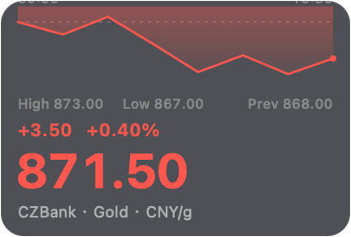
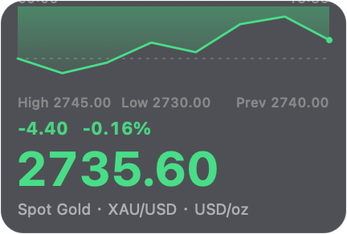

<div align="center">


# GoldTicker

### Minimalist Real-Time Gold Price Desktop Widget · Cross-Platform Lightweight Ticker

<p align="center">
  <a href="README.md">简体中文</a> | <b>English</b>
</p>

[](https://github.com/realsuperj/gold-ticker/actions)
[](LICENSE)
[](https://github.com/realsuperj/gold-ticker/releases)

<p align="center">
  Supporting <b>Shanghai Gold Exchange Au99.99</b>, <b>Spot Gold (XAU/USD)</b>, and major Chinese commercial bank accumulation gold (<b>CZBank</b>, ICBC, CCB).<br/>
  Featuring native macOS frosted glass floating card & status bar item, alongside Windows lightweight tray ticker & desktop widget.
</p>

<p align="center">
  
  &nbsp;&nbsp;
  
</p>
<p align="center">
  <sub>Left: CZBank Gold Accumulation (Smooth Intraday Chart, CNY/g) &nbsp; | &nbsp; Right: Spot Gold XAU/USD (Real-time Quote, USD/oz)</sub>
</p>

</div>

---

## Key Features

- 🌟 **Comprehensive Quotes**: Aggregates Shanghai Gold Exchange Au99.99 benchmark, international spot gold (XAU/USD native USD quote), and commercial bank gold accumulation quotes in real time.
- 🪟 **Minimalist Native Aesthetic**: Native macOS translucent frosted glass floating card and menu bar icon; Windows dynamic tray ticker, staying unobtrusive and quiet.
- 📈 **Dynamic Intraday Chart**: Smooth intraday curve with previous close baseline, providing an immediate sense of market fluctuations; collapsible at will.
- 🔄 **Dual Entry Interlock**: Seamlessly switch between desktop card and menu bar/tray icon. Hide the card and keep the ticker running quietly in the menu bar.
- 🎨 **User-Centric Color Scheme**: Color settings stay consistent across all targets. Red-Up/Green-Down (CN standard) or Green-Up/Red-Down (International standard) can be switched with one click.
- 🌐 **Lightweight Internationalization (i18n)**: Out-of-the-box support for English and Simplified Chinese, with auto-detection of system locale and in-app menu language switcher.

---

## Supported Targets & Bank Spread Calculation

GoldTicker is committed to transparent financial data processing. The quote models for the 5 core targets are detailed below:

| Target ID | Display Name | Unit | Source Mechanism | Description |
| :--- | :--- | :--- | :--- | :--- |
| `au9999` | SGE Spot Au99.99 | CNY/g | Direct Shanghai Gold Exchange Feed | The official spot gold benchmark in China |
| `xau_usd` | Spot Gold (XAU/USD) | USD/oz | Direct London Bullion Feed | Native USD pricing without currency distortion |
| `zs_jcj` | CZBank Gold | CNY/g | Direct CZBank Public Feed | Direct real-time quotes from China Zheshang Bank |
| `icbc_jcj` | ICBC Gold | CNY/g | Au99.99 Benchmark + **0.80 CNY/g** | **Estimated Spread** (ICBC lacks public API; modeled via spread) |
| `ccb_jcj` | CCB Gold | CNY/g | Au99.99 Benchmark + **0.75 CNY/g** | **Estimated Spread** (CCB lacks public API; modeled via spread) |

> **Spread Estimation Note**: Because ICBC and CCB do not offer public unauthorized REST endpoints, GoldTicker calculates their real-time prices using the `SGE Au99.99 Benchmark + Bank Average Daily Spread` model. These are marked as "Estimated Spread" in the UI for cross-bank comparison. Please consult official banking apps for actual transaction executions.

---

## Installation & Quick Start

### Method 1: Download Release Binaries (Recommended)
Visit the [Releases](https://github.com/realsuperj/gold-ticker/releases) page to download pre-built packages:
- **macOS**: Download `GoldTicker-macOS-Universal2.dmg`, double click and drag to `Applications`.
- **Windows**: Download standalone `GoldTicker.exe` (or `GoldTicker-standalone-win-x64.zip`), double click to run directly without dependencies.

### Method 2: Run from Source

#### macOS Local Install & Launch
```bash
# 1. Install dependencies (Python 3.9+)
pip install -r requirements.txt

# 2. Install as native macOS App
./install.sh                # Install to ~/Applications/GoldTicker.app
./install.sh --autostart    # Also register launch daemon for login autostart
```

#### Windows Local Launch
```powershell
# 1. Install dependencies
pip install -r requirements.txt

# 2. Start Windows presentation layer
python windows/main.py
```

---

## Menu Controls (Action Matrix)

Right-click on the desktop floating card, or click the menu bar / system tray icon to reveal all options:

| <nobr>Category&nbsp;&nbsp;&nbsp;&nbsp;&nbsp;&nbsp;&nbsp;&nbsp;</nobr> | <nobr>Option&nbsp;&nbsp;&nbsp;&nbsp;&nbsp;&nbsp;&nbsp;&nbsp;</nobr> | Description |
| :--- | :--- | :--- |
| <nobr>**View Entry**</nobr> | Show on Desktop / Show on Menu Bar | Independently hide the floating card while keeping menu bar active |
| <nobr>**Chart Auxiliary**</nobr> | Show Chart / Show Details | Toggle intraday trend chart and High/Low/Base values |
| <nobr>**Window Level**</nobr> | Always on Top | Float above all windows or stay on desktop level |
| <nobr>**Target Selection**</nobr> | Au99.99 / Spot Gold / CZBank / ICBC / CCB | Quick switch between domestic gold and international quotes |
| <nobr>**Change Basis**</nobr> | Prev Close / Open Price | Switch reference baseline for delta and percentage calculations |
| <nobr>**Color Scheme**</nobr> | Red Up Green Down / Green Up Red Down | User-centric color rule that applies globally across all targets |
| <nobr>**Language**</nobr> | Auto / 简体中文 / English | Seamless lightweight bilingual interface switching |
| <nobr>**Refresh Interval**</nobr> | 10s / 15s / 30s / 60s / 300s | Flexible polling frequency options |
| <nobr>**Customization**</nobr> | Width (180~280pt) / Opacity (60%~100%) | Multi-tier visual dimensions |
| <nobr>**Maintenance**</nobr> | Open Config Dir / Reset Position / Reload | Quick access to configuration file and window repositioning |

---

## License & Disclaimer

- Open-sourced under the **[MIT License](LICENSE)**. Copyright © 2026 realsuperj.
- **Disclaimer**: This software is provided solely for personal tracking and research. It does not constitute investment or trading advice. Data feeds are sourced from publicly available internet endpoints with network transmission latency. Official broker and banking clients govern all actual executions.
