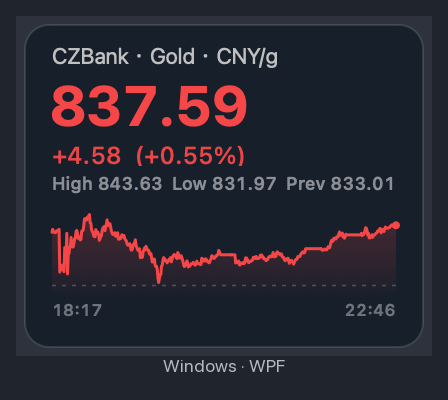

<div align="center">


# GoldTicker

### Minimalist Real-Time Gold Price Desktop Widget · Cross-Platform Lightweight Ticker

<p align="center">
  <a href="README.md">简体中文</a> | <b>English</b>
</p>

[](https://github.com/realsuperj/gold-ticker/releases/tag/v1.2.0)
[](https://github.com/realsuperj/gold-ticker/actions)
[](LICENSE)
[](https://github.com/realsuperj/gold-ticker/releases)

<p align="center">
  <a href="https://github.com/realsuperj/gold-ticker/releases/latest/download/GoldTicker-macOS-Universal2.dmg"><strong>⬇️ Download macOS DMG</strong></a>
  &nbsp;·&nbsp;
  <a href="https://github.com/realsuperj/gold-ticker/releases/latest/download/GoldTicker.exe"><strong>⬇️ Download Windows EXE</strong></a>
  &nbsp;·&nbsp;
  <a href="https://github.com/realsuperj/gold-ticker/releases/latest">All releases</a>
</p>

<p align="center">
  Supporting <b>Shanghai Gold Exchange Au99.99</b>, <b>Spot Gold (XAU/USD)</b>, and major Chinese commercial bank accumulation gold (<b>CZBank</b>, ICBC, CCB).<br/>
  macOS: native frosted desktop card + menu bar. Windows: native WPF floating desktop card (no taskbar ticker strip).
</p>

<p align="center">
  
  
</p>
<p align="center">
  <sub>Left: macOS · Right: Windows (WPF). CZBank gold card visuals.</sub>
</p>

</div>

---

## Key Features

- 🌟 **Comprehensive Quotes**: Aggregates Shanghai Gold Exchange Au99.99, international spot gold (XAU/USD native USD quote), and commercial bank accumulation gold in real time.
- 🪟 **Minimalist Native UI**: macOS uses AppKit frosted glass card + menu bar item; Windows uses .NET Framework 4.8 + WPF floating desktop card — no wide taskbar ticker, stays out of the way.
- 📈 **Dynamic Intraday Chart**: Smooth curve with previous-close baseline; collapsible chart with adaptive card height.
- 🔄 **Entry & Controls**: Right-click the card for the full menu on both platforms; macOS also supports desktop card + menu bar dual entry (hide either side independently).
- 🎨 **User-Centric Colors**: Red-up/green-down (CN) or green-up/red-down (intl), applied globally across symbols.
- 🌐 **Bilingual**: Simplified Chinese / English, follow system or pick manually.

---

## Supported Targets & Bank Spread Calculation

GoldTicker is committed to transparent financial data processing. The quote models for the 5 core targets are detailed below:

| Target ID | Display Name | Unit | Source Mechanism | Description |
| :--- | :--- | :--- | :--- | :--- |
| `au9999` | SGE Spot Au99.99 | CNY/g | Direct Shanghai Gold Exchange Feed | The official spot gold benchmark in China |
| `xau_usd` | Spot Gold (XAU/USD) | USD/oz | Direct London Bullion Feed | Native USD pricing without currency distortion |
| `zs_jcj` | CZBank Gold | CNY/g | Direct CZBank Public Feed | Direct real-time quotes from China Zheshang Bank |
| `icbc_jcj` | ICBC Gold | CNY/g | Au99.99 Benchmark + **0.80 CNY/g** | **Estimated Spread** (ICBC lacks public API; modeled via spread) |
| `ccb_jcj` | CCB Gold | CNY/g | Au99.99 Benchmark + **0.75 CNY/g** | **Estimated Spread** (CCB lacks public API; modeled via spread) |

> **Spread Estimation Note**: Because ICBC and CCB do not offer public unauthorized REST endpoints, GoldTicker calculates their real-time prices using the `SGE Au99.99 Benchmark + Bank Average Daily Spread` model. These are marked as "Estimated Spread" in the UI for cross-bank comparison. Please consult official banking apps for actual transaction executions.

---

## Installation & Quick Start

### Method 1: Download Release Binaries (Recommended)

From [Releases](https://github.com/realsuperj/gold-ticker/releases/latest):

- **macOS**: [`GoldTicker-macOS-Universal2.dmg`](https://github.com/realsuperj/gold-ticker/releases/latest/download/GoldTicker-macOS-Universal2.dmg) (Intel / Apple Silicon) — drag to `Applications`.
- **Windows**: [`GoldTicker.exe`](https://github.com/realsuperj/gold-ticker/releases/latest/download/GoldTicker.exe) standalone (or [`GoldTicker-Windows-x64.zip`](https://github.com/realsuperj/gold-ticker/releases/latest/download/GoldTicker-Windows-x64.zip)) — double-click, no companion DLLs.

### Method 2: Build from Source

Shared rules live in `shared/spec.json`. Runtimes are native — macOS: `mac-native/GoldTicker.m` (Objective-C + AppKit), Windows: `windows-wpf/` (.NET Framework 4.8 + WPF). Release binaries are **`< 1 MB`**.

#### macOS Local Install & Launch
```bash
# Build native Universal2 app and install
./install.sh                # Install to ~/Applications/GoldTicker.app
./install.sh --autostart    # Also register launch daemon for login autostart
```

#### Windows Local Build & Launch
```powershell
.\tools\build_windows_wpf.ps1
.\dist\windows\GoldTicker.exe
```

---

## Menu Controls (Action Matrix)

Right-click the desktop floating card for the full menu; **macOS** can also use the menu bar icon.

| Category | Option | Description |
| :--- | :--- | :--- |
| **View Entry** (macOS) | Show on Desktop / Show on Menu Bar | Hide either side independently; keep at least one entry |
| **Chart Auxiliary** | Show Chart / Show Details | Toggle intraday chart and High/Low/base values |
| **Window Level** | Always on Top | Float above other windows or stay on desktop level |
| **Target Selection** | Au99.99 / Spot Gold / CZBank / ICBC / CCB | Switch CNY/g and USD/oz quotes |
| **Change Basis** | Prev Close / Open Price | Baseline for delta and percent change |
| **Color Scheme** | Red Up Green Down / Green Up Red Down | Global color rule across symbols |
| **Language** | Auto / 简体中文 / English | Full UI bilingual switching |
| **Refresh Interval** | 10s / 15s / 30s / 60s / 300s | Polling frequency |
| **Customization** | Width / Opacity | Multi-tier width and 60%–100% opacity |
| **Maintenance** | Open Config Dir / Reset Position / Reload | Config folder and reposition to top-right |
| **Updates** | Check for Updates | Check for and install a newer version |

---

## License & Disclaimer

- Open-sourced under the **[MIT License](LICENSE)**. Copyright © 2026 realsuperj.
- **Disclaimer**: This software is provided solely for personal tracking and research. It does not constitute investment or trading advice. Data feeds are sourced from publicly available internet endpoints with network transmission latency. Official broker and banking clients govern all actual executions.
